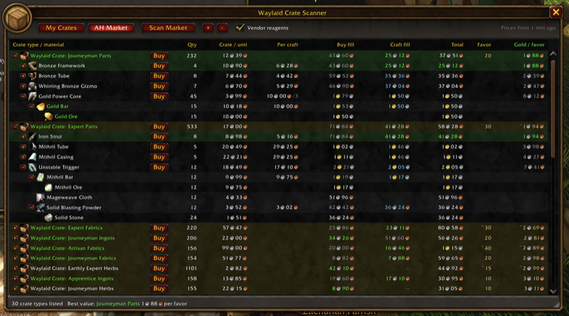
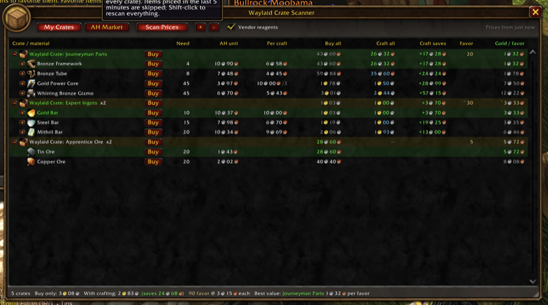
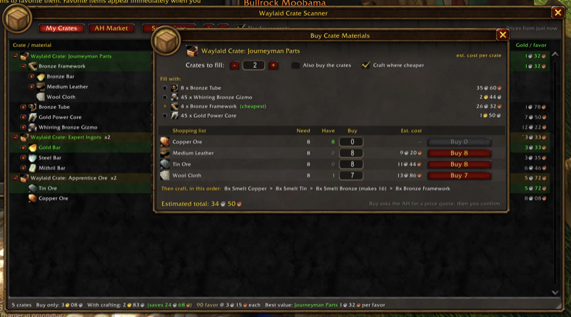

# Waylaid Crate Scanner

Spend less gold on Waylaid Crates. This addon finds the cheapest way to fill each crate and shows which crate gets you Merchant's Favor for the least gold. Then it makes a shopping list you can buy from the Auction House.

For WoW: Forever.

## What it does for you

- **Fill your crates for less.** It prices every way to fill the crates in your bags. For each item, it checks buying it and crafting it, at every step, and uses the cheaper one.
- **Get Merchant's Favor for less.** It compares every crate on the Auction House. You see the crate's price, the cost to fill it, and the gold you pay for each point of favor.
- **Buy it in a few clicks.** It builds a shopping list for any crate, and you buy each line without leaving the window.

## Fill the crates you have

1. Open the Auction House and click the **Crates** tab.
2. Click **My Crates**, then **Scan Prices**.
3. Each crate shows its cheapest fill. Green marks the best option. Click a row to see what goes into it.

## Find the cheapest Merchant's Favor

1. Click **AH Market**, then **Scan Market**. A full scan takes about 2 minutes.
2. The list is sorted by **Gold / favor**, cheapest first.
3. The best crate is green and named at the bottom of the window.

Gold / favor counts the crate's price plus the cheapest way to fill it.

## Buy what you need

1. Click **Buy** on a crate, or on one of its options.
2. Set how many crates to fill. Leave **Craft where cheaper** on to craft only when it saves gold. The window lists the crafting steps in order.
3. Click **Buy** on a line to get a price from the Auction House. Click **Confirm** to buy it, or **X** to cancel.

The list counts what is in your bags and what you bought that is still in your mailbox. You won't buy the same thing twice.

## Good to know

- Scanning needs the Auction House open. Prices stay until you log out, and a `/reload` keeps them.
- A scan skips items priced in the last 5 minutes. Shift-click the scan button to scan everything.
- Crafting costs assume you, or a friend, can craft the item.
- Expert and Artisan favor amounts are estimates, marked with `~`. When you see the real amount, enter it, for example: `/wcs favor artisan uncommon 40`.
- It works alongside Auctionator. Both tabs show on the Auction House.

## Commands

- `/wcs` opens or closes the window. You can also use the minimap addon menu.
- `/wcs favor` shows the favor amounts.
- `/wcs help` lists all commands.
